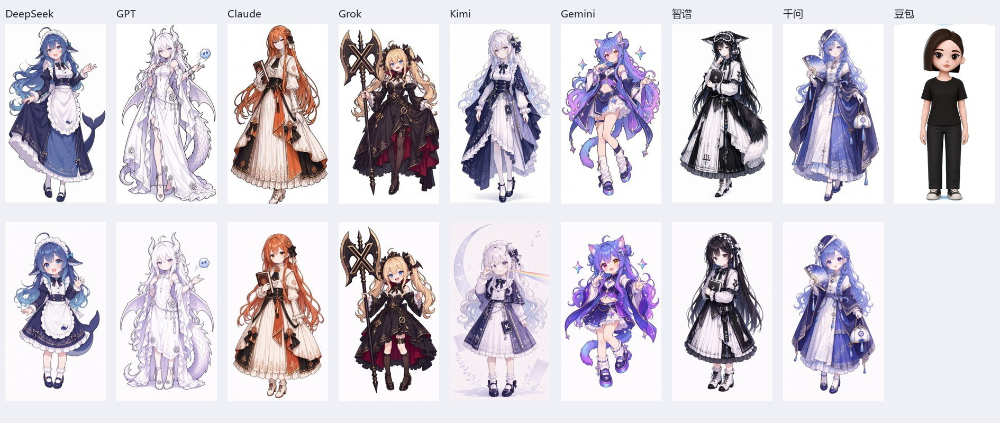
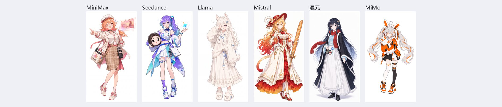

# AI Character Art Archive · ai-girls

[中文](README.md) | **English**

A collection of initial character designs, chibi art, and turnarounds for personified AI characters. Use it to look designs up, keep a character consistent, or make derivative work that follows the original authors' terms.





## Collection status

As of **2026-10-20**, this archive holds **32 images** and **1** DeepSeek vocal stem. Lightweight previews are stored separately and are not counted as source files. See the [DeepSeek notes](characters/deepseek/README.md) for the vocal.

**The portrait set is still incomplete.** Clear chibi frames exist only for eight characters from *Big AIs and Little AIs*. The original chibi files have not been obtained. MiniMax appears in that video, but the frame has not been extracted. DeepSeek also has community turnarounds. MiMo has turnarounds from the character's own author. ZipZipPipe's Seedance full-body portrait is in the [Seedance directory](characters/seed/). No author-original turnaround exists for that character.

| Character / directory | Initial full-height portrait | Chibi (author's little-AI version) | Full-height turnaround | Chibi turnaround |
| --- | --- | --- | --- | --- |
| [DeepSeek](characters/deepseek/) | Author original + 2 variants | Frame at 5s; original file missing | Community reference; artist unverified | Community reference; artist unverified |
| [GPT / ChatGPT](characters/gpt/) | Author original | Frame at 23s; original file missing | Not collected | Not collected |
| [Claude](characters/claude/) | Author original + 1 workwear variant | Frame at 17s; original file missing | Not collected | Not collected |
| [Grok](characters/grok/) | Author original | Frame at 29s; original file missing | Not collected | Not collected |
| [Kimi](characters/kimi/) | Author original | Frame at 41s; original file missing | Not collected | Not collected |
| [Gemini](characters/gemini/) | Author original | Frame at 11s; original file missing | Not collected | Not collected |
| [GLM](characters/glm/) | Author original | Frame at 35s; original file missing | Not collected | Not collected |
| [Qwen](characters/qwen/) | Author original | Frame at 53s; original file missing | Not collected | Not collected |
| [MiniMax](characters/minimax/) | Author original | Shown in the video; frame not extracted | Not collected | Not collected |
| [Seedance](characters/seed/) | Author original | Not collected | Not collected | Not collected |
| [Llama](characters/llama/) | Author original + 1 variant | Not collected | Not collected | Not collected |
| [Mistral](characters/mistral/) | Author original | Not collected | Not collected | Not collected |
| [Hunyuan](characters/hunyuan/) | Author original | Not collected | Not collected | Not collected |
| [MiMo / Xiaomi](characters/mimo/) | Original by 甶丶, not ZipZipPipe | Not collected | Author original: front / side / back | Not collected |
| [Doubao](characters/doubao/) | Official avatar; full body generated from that avatar | Not collected | Front / side / back generated from that avatar | Not collected |

`adult` is only the directory for full-height designs. **It does not mean the author confirmed the character's age.** Chibi files follow the "little AI" versions ZipZipPipe first showed. Later two-head-tall redesigns by other people are not used as substitutes.

"Initial design" means the version that matches the author's early presentation. Files come from high-resolution collections the author published. The collection date is not the date the character was first designed.

## Where to look

```text
ai-girls/
├── README.md                     # Chinese overview, status, and usage
├── README.en.md                  # English overview
├── NOTICE.md                     # Attribution and license boundaries
├── catalog.json                  # Source, size, checksum, and status for each file
├── characters/
│   ├── deepseek/
│   │   ├── README.md
│   │   ├── DeepSeek娘_人声.mp3   # Isolated vocal from a cover of 《人是猫》
│   │   ├── adult/                # Author originals and variants
│   │   ├── chibi/                # Chibi frames from the author's video
│   │   └── turnarounds/          # Community turnarounds
│   ├── gpt/                      # Notes, adult/, chibi/
│   ├── claude/
│   ├── grok/
│   ├── kimi/
│   ├── gemini/
│   ├── glm/
│   ├── qwen/
│   ├── minimax/
│   ├── seed/                     # ZipZipPipe's Seedance design
│   ├── llama/
│   ├── mistral/
│   ├── hunyuan/
│   ├── mimo/                     # Xiaomi MiMo by 甶丶, including turnarounds
│   └── doubao/                   # Official avatar, plus a generated full body and turnaround
├── previews/                     # Lightweight previews, separate from originals
├── sources/source-records.json   # Source-verification notes
└── scripts/verify.py              # Local integrity check
```

Each character README links the preview, the original file, and the exact source. Author originals and downloaded turnarounds keep their original format, pixel size, and bytes. Video frames are PNG and keep the full frame, background, and presentation. They are not cropped, upscaled, or redrawn.

[catalog.json](catalog.json) is the machine-readable index. Each asset records `character_id`, `asset_type`, `form`, `source_id`, `path`, source page or video timestamp, dimensions, file size, SHA-256, credit, and license status. `characters[].coverage` and `missing` record what has and has not been collected.

## Sources

| Source | How this archive uses it |
| --- | --- |
| [ZipZipPipe · Pixiv](https://www.pixiv.net/users/18604994) / [*AI Musume*](https://www.pixiv.net/artworks/148186519) | Original portrait files from the author's own collection. Exact pages are recorded in the character notes and the catalog |
| [ZipZipPipe · Pixiv](https://www.pixiv.net/users/18604994) / [*Some updates*](https://www.pixiv.net/artworks/150718881) | Later originals from 2026-10-11. Only pages that match a character are kept |
| [ZipZipPipe · Bilibili post](https://www.bilibili.com/opus/1236803362705375305) | Originals from 2026-08-15. Files that duplicate *AI Musume* are not stored again. The Seedance full-body file is Pixiv page 11. This archive also keeps the DeepSeek short-skirt maid |
| [甶丶 · *MiMo personified*](https://www.bilibili.com/opus/1242097128919007239) | Xiaomi MiMo portrait and turnaround. ZipZipPipe did not design this set. The author states CC BY-NC |
| [ZipZipPipe · Bilibili](https://space.bilibili.com/4168597) / [*Big AIs and Little AIs*](https://www.bilibili.com/video/BV1tE9XBbErS/) | Used to check the tall and chibi designs, and to extract chibi frames for eight requested characters |
| [*The women worth hundreds of millions*](https://www.bilibili.com/video/BV1bARXBYEZz/) | The author's statement that the pictures may be shared and used for further creation |
| [Gengjing · turnaround set](https://aigengtu.com/refs) | Two community references for DeepSeek: long-skirt maid and chibi blue maid. The artists are unverified |
| [星落落_oi · cover of *人是猫*](https://www.bilibili.com/video/BV1fYpn6SEk9/) | Isolated DeepSeek vocal. The upload says it may not be reposted without permission |
| [Doubao website](https://www.doubao.com/) | The official short-haired avatar published on the site |

DeepSeek keeps the full authorship chain: **[上善无形](https://space.bilibili.com/4456176)'s original whale character → ZipZipPipe's DeepSeek maid redesign**. See the [source records](sources/source-records.json).

## Credit and use

Rights in the files and character designs stay with their creators and rightsholders. This repository is a community index.

- **DeepSeek**: the author explicitly uses [CC BY-NC-SA 4.0](https://creativecommons.org/licenses/by-nc-sa/4.0/deed.en). Credit, non-commercial use, and share-alike are required. The community turnarounds still need a verified artist and statement.
- **Other ZipZipPipe characters**: the author has said the pictures may be shared and reused, but this archive has not verified one standard license for all of them. They are not relabeled CC0 or MIT.
- **Official Doubao material**: the official source and copyright remain. A public avatar is not an open license for other uses.

The full statement is in [NOTICE.md](NOTICE.md). Keep the matching source and credit when you use a file.

## Check and additions

From the repository root, with Python 3 and no extra dependencies:

```bash
python scripts/verify.py
```

The check covers SHA-256, file size, previews, character notes, and catalog coverage. It verifies the files that are present. It does not mean every missing asset has been collected.

Prefer the author's original posts, work pages, or an explicitly published pack when adding files. Record the work URL, author, form, type, and license. When an original chibi file is obtained, store it separately from the video frame. Full-height and chibi turnarounds should each show front, side, and back. If a file cannot be verified, keep it marked "not collected" or "source unverified" instead of substituting another design.
