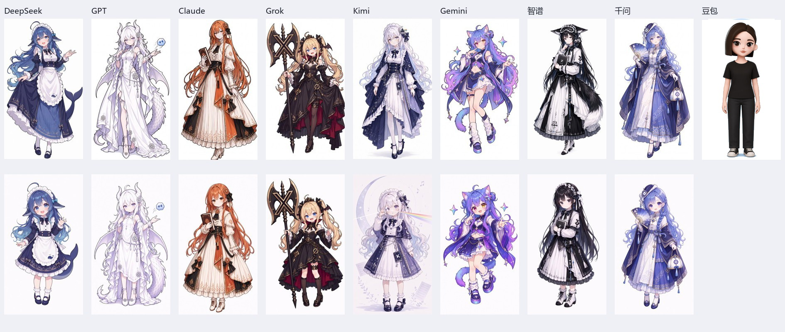

# AI 娘素材档案 · ai-girls

收集 AI 拟人角色的初始设计立绘、Q 版和三视图，供查阅、角色一致性参考及遵守原作者许可的二次创作使用。

首批：**DeepSeek、GPT、Claude、Grok、Kimi、Gemini、智谱 GLM、千问 Qwen、豆包**。前八位以 **ZipZipPipe** 的设计为准，豆包采用官方形象。需求中的 `gmini` 统一为 `Gemini`。



## 收集进度

截至 **2026-10-01**，保存了 **21 份图像素材**：10 张作者原图（8 张初始设计立绘、2 张变体）、8 张作者视频中的 Q 版展示截帧、2 张社区补充三视图、1 张豆包官方头像。轻量预览另外存放，不计入原素材数量。**2026-10-18** 另存入 1 份 DeepSeek 纯人声参考，见 [DeepSeek 说明](characters/deepseek/README.md)。

**这批素材尚未齐全。** Q 版暂用作者原视频的清晰截帧，原始图像文件仍待补；只有 DeepSeek 找到了社区补充三视图，其余角色三视图及豆包全身设定仍缺失。社区三视图未核实具体绘制者，不标为 ZipZipPipe 原稿。

| 角色 / 素材目录 | 初始设计正常比例立绘 | Q 版（作者小 AI 版） | 正常比例三视图 | Q 版三视图 |
| --- | --- | --- | --- | --- |
| [DeepSeek](characters/deepseek/) | 作者原图 + 1 张变体 | 作者视频 5 秒截帧；原图待补 | 社区补充，绘制者待核实 | 社区补充，绘制者待核实 |
| [GPT / ChatGPT](characters/gpt/) | 作者原图 | 作者视频 23 秒截帧；原图待补 | 待收集 | 待收集 |
| [Claude](characters/claude/) | 作者原图 | 作者视频 17 秒截帧；原图待补 | 待收集 | 待收集 |
| [Grok](characters/grok/) | 作者原图 | 作者视频 29 秒截帧；原图待补 | 待收集 | 待收集 |
| [Kimi](characters/kimi/) | 作者原图 | 作者视频 41 秒截帧；原图待补 | 待收集 | 待收集 |
| [Gemini](characters/gemini/) | 作者原图 + 1 张变体 | 作者视频 11 秒截帧；原图待补 | 待收集 | 待收集 |
| [智谱 / GLM](characters/glm/) | 作者原图 | 作者视频 35 秒截帧；原图待补 | 待收集 | 待收集 |
| [千问 / Qwen](characters/qwen/) | 作者原图 | 作者视频 53 秒截帧；原图待补 | 待收集 | 待收集 |
| [豆包 / Doubao](characters/doubao/) | 仅官方头像；全身立绘待补 | 官方全身版本待补 | 待收集 | 待收集 |

`adult` / 成年版仅指正常比例形象的目录分类，**不代表作者确认了角色年龄**。Q 版采用 ZipZipPipe 最初展示的“小 AI”版本，不以其他作者后来改设的二头身版本替代。

“初始设计立绘”指与作者早期展示相符的设计版本，文件取自其本人发布的高清合集；合集发布时间不等于角色首次设计日期。

## 文件怎么找

```text
ai-girls/
├── README.md                     # 总览、进度、使用说明
├── NOTICE.md                     # 署名与素材许可边界
├── catalog.json                  # 每份素材的来源、尺寸、校验值和状态
├── characters/
│   ├── deepseek/
│   │   ├── README.md
│   │   ├── DeepSeek娘_人声.mp3   # 《人是猫》翻唱纯人声参考
│   │   ├── adult/                # 作者原图及变体
│   │   ├── chibi/                # 作者视频的 Q 版展示截帧
│   │   └── turnarounds/          # 社区补充三视图
│   ├── gpt/                      # 说明、adult/、chibi/
│   ├── claude/
│   ├── grok/
│   ├── kimi/
│   ├── gemini/
│   ├── glm/
│   ├── qwen/
│   └── doubao/official/          # 豆包官方公开素材
├── previews/                     # 轻量预览，与原图分开
├── sources/source-records.json   # 来源核验记录
└── scripts/verify.py              # 本地完整性校验
```

点击角色目录内的 README，可查看图片预览、原文件和精确来源。作者原图及下载的三视图保留原格式、原尺寸和原始字节；视频截帧保存为 PNG，保留完整画面、背景和展示效果，未裁切、放大或重绘。

机器读取使用 [catalog.json](catalog.json)：每份素材记录 `character_id`、`asset_type`、`form`、`source_id`、`path`、来源页码或视频秒数、尺寸、文件大小、SHA-256、署名及许可状态。`characters[].coverage` 和 `missing` 明确记录收集情况。

## 来源

| 来源 | 本仓库使用方式 |
| --- | --- |
| [ZipZipPipe · Pixiv](https://www.pixiv.net/users/18604994) / [《AI娘化》](https://www.pixiv.net/artworks/148186519) | 作者本人合集的原始立绘文件；精确页码记录在角色说明及清单中 |
| [ZipZipPipe · Bilibili](https://space.bilibili.com/4168597) / [《大AI和小AI们》](https://www.bilibili.com/video/BV1tE9XBbErS/) | 核对大、小两种设计，提取八位需求角色的 Q 版展示截帧 |
| [《“亿万”身家的她们》](https://www.bilibili.com/video/BV1bARXBYEZz/) | 作者关于图片开放分享及再创作的说明 |
| [梗鲸 · 三视图设定集](https://aigengtu.com/refs) | DeepSeek 长裙女仆 / Q 版蓝女仆两张社区参考，绘制者未核实 |
| [星落落_oi ·《人是猫》翻唱](https://www.bilibili.com/video/BV1fYpn6SEk9/) | DeepSeek 纯人声参考；成片注明未经授权禁止转载 |
| [豆包官网](https://www.doubao.com/) | 官网公开的官方短发女性头像 |

DeepSeek 需保留完整创作链：**[上善无形](https://space.bilibili.com/4456176)原始鲸鱼娘角色 → ZipZipPipe 的 DeepSeek 女仆二次设计**。详见 [来源核验记录](sources/source-records.json)。

## 署名与使用

素材及角色设计的相关权利归各自创作者和权利人所有；本仓库为社区整理。

- **DeepSeek**：作者明确声明采用 [CC BY-NC-SA 4.0](https://creativecommons.org/licenses/by-nc-sa/4.0/deed.zh-hans)，须署名、非商业使用、相同方式共享。社区补充三视图仍需核实具体绘制者及对应声明。
- **其他 ZipZipPipe 角色**：作者有开放分享及再创作的说明，但本次未核实统一的标准许可证；不自行改标为 CC0 或 MIT。
- **豆包官方素材**：保留官方来源和版权归属；公开头像不意味着获得其他用途的开放授权。

完整说明见 [NOTICE.md](NOTICE.md)。使用时请保留对应来源和署名。

## 校验与补充

在仓库根目录执行，Python 3 即可，无额外依赖：

```bash
python scripts/verify.py
```

校验检查素材 SHA-256、文件大小、预览、角色说明及清单覆盖。它验证文件完整性，不代表缺失素材已收集完毕。

后续补充优先采用作者原始动态、作品页或明确发布的素材包。新增文件需记录作品链接、作者、形态、类型及许可；获得 Q 版原图后与截帧区分保存。成年和 Q 版三视图应分别具备正面、侧面、背面。无法核实的素材继续标注“待收集”或“来源待核实”，不以其他设计替代。
